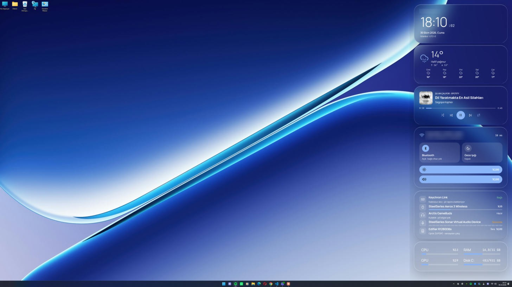
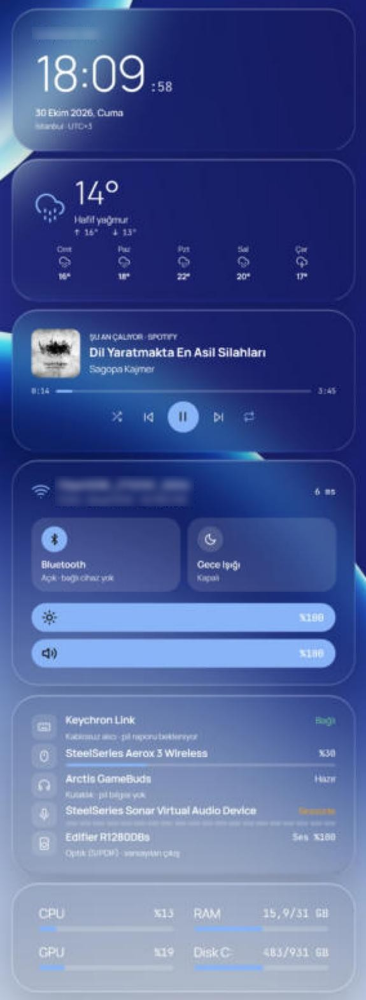
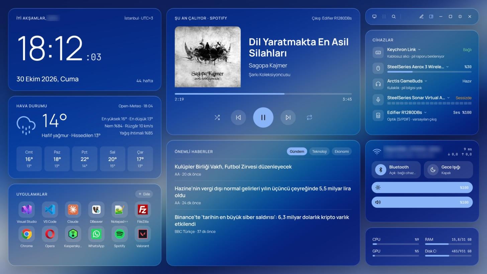
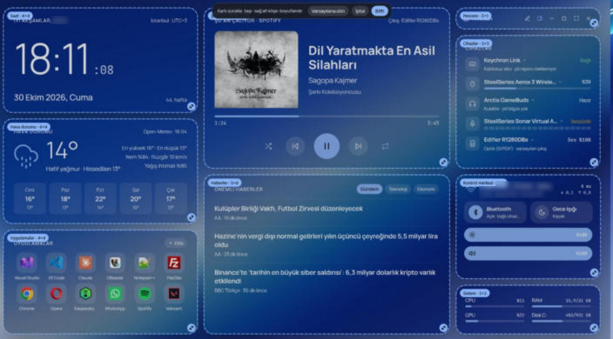

# WinDash

Windows için cam (glass) görünümlü, özelleştirilebilir kişisel gösterge paneli. C# / .NET 8 / WPF.

Saat, hava durumu, çalan müzik, haberler, sık kullanılan uygulamalar, Wi-Fi / Bluetooth / parlaklık / ses kontrolleri,
çevre birimlerinin pil durumu ve sistem kaynaklarını tek ekranda gösterir. Üç şekilde kullanılabilir:

- **Pencere / tam ekran:** ikinci bir ekranda tam ekran ya da tek ekranda normal bir pencere olarak,
- **Masaüstüne gömülü:** masaüstünün sağ kenarında, pencerelerin arkasında duran sade cam kartlar olarak,
- **Arka planda:** pencere kapalıyken bildirim alanında (tepside) çalışmaya devam eder.

WinDash **hiçbir bilgisayara, markaya veya kişiye bağlı değildir**: adını Windows hesabından, konumunu Windows konum
hizmetinden, cihazlarını Windows'un aygıt listesinden, uygulamalarını Başlat menüsünden kendisi bulur. Kurduktan sonra
hiçbir ayar yapmadan çalışır; `appsettings.json` yalnızca varsayılanları değiştirmek isteyenler içindir.

## Ekran görüntüleri

### Masaüstüne gömülü

Kartlar masaüstünün sağında, ekran genişliğinin %20'sinde ve tam yükseklikte durur; camı duvar kâğıdının o bölgesinin
bulanık halidir.

<table>
  <tr>
    <td width="72%"></td>
    <td width="28%"></td>
  </tr>
</table>

### Program açıkken

Tam ekran WinDash: saat, hava durumu, uygulamalar, şu an çalıyor, haberler, Pencere kartı, cihazlar, kontrol merkezi
ve sistem.



### Düzenle modu

Kartları sürükleyerek taşı, sağ alt köşedeki tutamaktan boyutlandır; üstteki çubukta Varsayılana dön · İptal · Bitti.



> Görüntülerde kişisel bilgiler (ad, Wi-Fi adı, IP adresi) bulanıklaştırılmıştır.

## İçindekiler

- [Ekran görüntüleri](#ekran-görüntüleri)
- [Özellikler](#özellikler)
- [Kurulum](#kurulum)
- [Kullanım](#kullanım)
  - [Pencere kartı ve modlar](#pencere-kartı-ve-modlar)
  - [Arka planda çalışma (bildirim alanı)](#arka-planda-çalışma-bildirim-alanı)
  - [Masaüstüne göm](#masaüstüne-göm)
  - [Düzenle: kartları taşı ve boyutlandır](#düzenle-kartları-taşı-ve-boyutlandır)
  - [WinDash ile kilitle ve oturum açılışı](#windash-ile-kilitle-ve-oturum-açılışı)
  - [Kısayollar](#kısayollar)
- [Kartlar](#kartlar)
- [Ayarlar](#ayarlar)
- [Gizlilik](#gizlilik)
- [Bilinen kısıtlar](#bilinen-kısıtlar)
- [Geliştirme](#geliştirme)
- [Sürüm geçmişi](#sürüm-geçmişi)

## Özellikler

| | |
|---|---|
| **Cam tasarım** | Masaüstü duvar kâğıdının bulanık kopyası üzerinde yarı saydam kartlar. Manrope ve JetBrains Mono gömülü. Tasarım alanı 1920x1080; her çözünürlükte oranını koruyarak ölçeklenir. Duvar kâğıdı değişince kendiliğinden yenilenir. |
| **Masaüstüne göm** | Kartlar masaüstünün sağında, ekran genişliğinin %20'sinde ve tam yükseklikte durur. Camı, o an görünen duvar kâğıdının birebir bulanık halidir; renkler değiştirilmez. |
| **Düzenle** | Hem pencerede hem masaüstünde kartları sürükleyerek taşı, köşesinden boyutlandır. |
| **Arka planda çalışma** | Küçült / Kapat pencereyi gizler, WinDash bildirim alanında çalışır. Tamamen çıkmak: Ctrl+Q veya tepsi menüsü > Çıkış. |
| **Kilit** | Win+Shift+L: WinDash ekranını gösterir, dokununca Windows'u kilitler. Oturum açılınca masaüstüne gömülü moda geçer. |
| **Kendini bulan cihazlar** | Klavye, fare, kulaklık, mikrofon ve hoparlör Windows'tan otomatik algılanır; Bluetooth ve bazı kablosuz cihazlarda pil yüzdesi. |
| **Kurulum** | Kullanıcı bazlı MSI (yönetici izni gerekmez), Windows ile başlatma, yeni sürümde "güncellemek istiyor musunuz?" sorusu. |

## Kurulum

### Gereksinimler

- Windows 10 2004 (19041) veya Windows 11, x64
- Derlemek için [.NET 8 SDK](https://dotnet.microsoft.com/download/dotnet/8.0) (veya daha yenisi). MSI, .NET çalışma
  zamanını içinde taşır; hedef bilgisayara ayrıca bir şey kurmak gerekmez.

### Kurulum paketini (MSI) üretmek

**`build-installer.cmd`**'ye çift tıkla (veya `.\build-installer.ps1 -Version 1.4.0`).
`artifacts\WinDash-Setup-1.4.0.msi` oluşur. WiX Toolset NuGet'ten kendiliğinden iner.

`build-installer-log.cmd` aynı işi pencere açık beklemeden yapar ve tüm çıktıyı `build.log` dosyasına yazar.

| Komut | Ne yapar |
|---|---|
| `build-installer.ps1 -Version 1.5.0` | Belirtilen sürümle MSI üretir |
| `build-installer.ps1 -FrameworkDependent` | Daha küçük MSI (hedef bilgisayarda .NET 8 Desktop Runtime gerekir) |
| `msiexec /i WinDash-Setup-<sürüm>.msi AUTOSTART=0` | Windows ile başlatmadan kurar |
| `msiexec /i WinDash-Setup-<sürüm>.msi /qn` | Sessiz kurulum / güncelleme (soru sormaz) |

**Yeni sürüm yayınlarken** sürüm numarasını artır; kurulum bunu güncelleme olarak tanır.

### MSI'ı çalıştırınca

| Durum | Pencere |
|---|---|
| WinDash kurulu değil | "WinDash *x.y.z* kurulacak" · **Kur** / İptal |
| Eski bir sürüm kurulu | "Bilgisayarınızda WinDash *eski* yüklü. Yeni sürüme (*yeni*) güncellemek istiyor musunuz?" · **Güncelle** / İptal |
| Aynı sürüm (yeniden derlenmiş paket) kurulu | "Aynı sürümü yeniden kurmak istiyor musunuz?" · **Güncelle** / İptal |
| Aynı MSI tekrar açıldı | **Onar** / **Kaldır** / İptal |
| Daha yeni bir sürüm kurulu | Hata verir ve durur (eski sürüme dönüş yok) |

Kur / Güncelle penceresindeki **"Windows açılınca WinDash'i başlat"** kutusu işaretli gelir. Kurulum:

- `%LOCALAPPDATA%\Programs\WinDash` klasörüne kurar (yönetici izni gerekmez),
- Başlat menüsüne **WinDash** kısayolu ekler,
- Windows açılışında başlatır (kutu işaretliyse) ve kurulum bitince uygulamayı açar,
- Güncellemede açık olan WinDash'i kapatır, eski sürümü kaldırıp yenisini kurar ve yeniden açar.
  Ayarlar, kart yerleşimleri ve seçimler `%LOCALAPPDATA%\WinDash` içinde olduğu için **korunur**
  (kaldırmada da silinmez).

Windows ile başlatma sonradan **sağ tık / tepsi menüsü > Windows ile başlat** ile açılıp kapatılabilir; Görev
Yöneticisi > Başlangıç uygulamaları'nda "WinDash" olarak görünür. Açılışta birkaç saniye bekler, ikinci ekran geç
gelirse 30 saniyeye kadar onu bekler ve odağı çalmadan açılır.

## Kullanım

### Pencere kartı ve modlar

Cihazlar kartının üstündeki cam **Pencere** kartı. Her simgenin üzerine gelince ne yaptığını anlatan bir ipucu çıkar.

| Düğme | Ne yapar |
|---|---|
| **Masaüstü** · **Başlat** · **Ara** | *Yalnızca tam ekranda:* masaüstünü göster, Başlat menüsünü aç, Windows aramasını aç (Win+S) |
| Düzenle (kalem) | Kartları taşı ve boyutlandır |
| Masaüstüne göm | Pencereyi gizler, kartları masaüstünün sağına yerleştirir |
| Küçült | Pencereyi gizler; WinDash bildirim alanında çalışmaya devam eder |
| Büyüt / Geri al | Monitörün görev çubuğu hariç alanını kaplar ↔ pencere |
| Tam ekran (F11) | Monitörün tamamını kaplar ↔ önceki mod |
| Kapat | Pencereyi gizler; WinDash arka planda çalışır (tamamen çıkmak: Ctrl+Q) |

Pencere modunda kartı tutup sürükleyerek pencereyi taşıyabilir, kenarlardan boyutlandırabilirsin. Karta çift tıklamak
büyütür. İlk açılışta 2+ ekran varsa tam ekran, tek ekranda pencere açılır; sonra son seçilen mod ve konum hatırlanır.

### Arka planda çalışma (bildirim alanı)

WinDash açıkken görev çubuğunun sağındaki bildirim alanında (Wi-Fi ve ses simgelerinin yanında) **WinDash simgesi**
durur. Simge gizli simgeler okunun (˄) altında kalırsa *Ayarlar > Kişiselleştirme > Görev çubuğu > Diğer sistem
tepsisi simgeleri*'nden açık konuma getirerek hep görünür yapabilirsin.

- **Küçült**, **Kapat**, Alt+F4 veya görev çubuğundan kapatma pencereyi yalnızca gizler; kartlar (müzik, pil, hava
  durumu…) çalışmaya devam eder. İlk seferde bunu anlatan bir Windows bildirimi çıkar.
- **Simgeye tıkla** → WinDash penceresi geri gelir. Başlat menüsünden WinDash'i yeniden açmak da aynı şeyi yapar.
- **Simgeye sağ tık** → WinDash'i aç · Masaüstüne göm · Düzenle · WinDash ile kilitle · Windows ile başlat ·
  Yenile · Ayar klasörünü aç · **Çıkış**.

### Masaüstüne göm

Pencere kartındaki **Masaüstüne göm** düğmesi (veya sağ tık / tepsi menüsü) WinDash penceresini gizler ve kartları
**masaüstünün sağ kenarında** sade cam kartlar olarak gösterir:

- Panelin genişliği **her çözünürlükte monitör genişliğinin %20'si**, yüksekliği görev çubuğu hariç tamamıdır.
- Varsayılan düzen tek sütundur: saat · hava durumu · şu an çalıyor · ağ, Bluetooth, parlaklık, ses · cihazlar · sistem.
  Uygulamalar ve haberler masaüstünde yoktur (istersen Düzenle / ayarlarla eklenebilir).
- Kartlar pencerelerin arkasında, duvar kâğıdının üzerinde durur; tıklansa da öne gelmez, odağı çalmaz.
  Görev çubuğunda ve Alt+Tab'da görünmez; *Masaüstünü göster* (Win+D) ile kaybolmaz.
- Kartlar çalışır durumdadır: müziği duraklatabilir, ses aygıtını değiştirebilirsin. Kartların arası saydamdır;
  oradaki masaüstü simgelerine tıklanabilir.
- **Cam, masaüstünde o an görünen duvar kâğıdının birebir bulanık halidir:** monitöre özel resim, yerleştirme biçimi
  (Doldur / Sığdır / Uzat / Ortala / Döşe / Yay) ve kenar rengi dahil üretilir; renkler, doygunluk ve parlaklık
  değiştirilmez. Üstüne yalnızca `CardTint` kadar ince bir renk gelir.
- Duvar kâğıdı değişince (Ayarlar, slayt gösterisi, Spotlight) panel birkaç saniye içinde kendiliğinden yenilenir.
- Seçim hatırlanır: bir sonraki açılışta doğrudan masaüstüne gömülü başlar. Kaldırmak için düğmeye / menüdeki seçeneğe
  yeniden tıkla. Gömülüyken tepsi simgesine tıklayarak tam paneli de açabilirsin.

### Düzenle: kartları taşı ve boyutlandır

Hem WinDash penceresinde hem masaüstü panelinde kartların yerini ve boyutunu kendin belirlersin:

- **WinDash penceresi:** Pencere kartındaki **kalem** düğmesi (veya sağ tık > *Düzenle*).
- **Masaüstü paneli:** fareyi kartların üzerine getir, sağ üstte beliren **kalem** düğmesine tıkla.
- **Tepsi menüsü > Düzenle:** gömülüyse masaüstü panelini, değilse pencereyi düzenler.

Düzenle modunda kartı tutup sürükle → **taşı**; sağ alt köşedeki yuvarlak tutamağı sürükle → **boyutlandır**.
Kartlar ızgaraya oturur, üstte kartın adı ve boyutu yazar. Üstteki çubukta **Bitti** (kaydet), **İptal** (geri al)
ve **Varsayılana dön** var. Kart küçültülürse içerik kırpılmaz, orantılı küçülür.

| Nerede | Izgara | Kaydedildiği yer |
|---|---|---|
| WinDash penceresi | 12 sütun x 12 satır | `%LOCALAPPDATA%\WinDash\layout.json` |
| Masaüstü paneli | 4 sütun, satırlar 20 birim (sayısı ekran yüksekliğine göre) | `%LOCALAPPDATA%\WinDash\state.json` → `DesktopLayout` |

### WinDash ile kilitle ve oturum açılışı

Windows'un kilit / parola ekranı (Win+L) ayrı, korumalı bir masaüstünde çizilir; hiçbir uygulama oraya bir şey
koyamaz. WinDash bu yüzden **kilitlemeden önce** kendi ekranını gösterir:

- **WinDash ile kilitle — `Win+Shift+L`** (veya tepsi / sağ tık menüsü): ana ekranda tam WinDash paneli açılır, diğer
  ekranlar kararır. Fareye / klavyeye dokununca ekran kapanır ve **Windows kilitlenir** → parola veya *Oturum aç*
  ekranı gelir.
- **Oturum açınca** (parolalı veya parolasız) ya da kilidi açınca WinDash kendiliğinden **masaüstüne gömülü** moda
  geçer. Windows açılışında da doğrudan masaüstüne gömülü başlar.
- **Boşta kalınca hiçbir şey yapmaz (varsayılan):** bilgisayarı kullanmadığında WinDash kendiliğinden açılmaz ve
  Windows'u kilitlemez. İstersen `Standby.IdleMinutes` ile ekran koruyucu gibi açılmasını sağlayabilirsin
  (tam ekran oyun, sunum ve video oynatılırken açılmaz; o durumda Windows'un kendi ekran koruyucusunu "(Yok)" yap).

### Kısayollar

| Kısayol | Ne yapar |
|---|---|
| **F5** | Ayarları ve yerleşimi yeniden yükler (pencere ve masaüstü paneli) |
| **F11** | Tam ekran |
| **Ctrl+Q** | Tamamen çıkış |
| **Win+Shift+L** | WinDash ile kilitle (her yerden; `Standby.LockHotkey`) |
| **Sağ tık** (boş alana) | Yenile · Ayar klasörü · Günlük · Düzenle · Masaüstüne göm · WinDash ile kilitle · Windows ile başlat · Gizle · Çıkış |

## Kartlar

| Tür | Ne gösterir | Kaynak |
|---|---|---|
| `clock` | Selamlama (Windows'taki adınla), saat, tarih, hafta numarası, şehir ve saat dilimi | Sistem saati, Windows hesabı |
| `weather` | Anlık durum, hissedilen, nem, rüzgâr, 5 günlük tahmin | Open-Meteo (anahtar gerekmez), konum otomatik |
| `media` | Çalan şarkı / video, kapak, ilerleme, oynat/duraklat/ileri/geri/karıştır/tekrarla | Windows medya oturumu (Spotify, tarayıcı, medya oynatıcı…) |
| `apps` | Sık kullanılan uygulamalar; tıkla-aç, kartta ekle / kaldır / sırala | Başlat menüsü "Tüm uygulamalar" (Store dahil) |
| `news` | Kategori sekmeli son haberler, tıklayınca tarayıcıda açılır | RSS / Atom |
| `devices` | Klavye, fare, kulaklık, mikrofon, hoparlör; pil ve bağlantı durumu; aygıt seçimi | HID + Core Audio + Bluetooth |
| `controls` | Wi-Fi, Bluetooth aç/kapat, Gece Işığı aç/kapat, ekran parlaklığı, ses seviyesi | Windows API'leri, DDC/CI |
| `system` | CPU, RAM, GPU, disk | Windows performans sayaçları |
| `window` | Pencere düğmeleri (yalnızca WinDash penceresinde) | Ana pencere |
| `calendar` | Ay görünümü, bugünün etkinlikleri (varsayılan yerleşimde kapalı) | `.ics` adresi (Google Takvim vb.) |
| `network` | Yalnızca Wi-Fi bilgisi (isteğe bağlı; `controls` içinde zaten var) | Windows ağ API'leri |

`"Variant": "compact"` → sade görünüm (masaüstü paneli bunu kullanır): `clock`, `weather`, `media`, `controls`,
`devices` için ayrı sade tasarım, `system` için 2x2 ızgara.

### Neyi kendisi bulur?

| Bilgi | Nereden | Elle değiştirmek için |
|---|---|---|
| Selamlamadaki ad | Windows hesabının görünen adının ilk kelimesi (yoksa kullanıcı adı) | `UserName` |
| Konum (hava durumu, şehir) | 1. Windows konum hizmeti → 2. IP'den şehir düzeyinde tahmin. Günde bir yenilenir | `Weather.Latitude` / `Longitude`, `Clock.LocationLabel` |
| Monitör | İkinci ekran varsa o, yoksa ana ekran | `Display.MonitorDeviceName` |
| Uygulamalar | Varsayılan listeden (Chrome, Edge, Firefox, Spotify, WhatsApp, Discord, Steam, VS Code, Office…) **bilgisayarda kurulu olanlar** | Kartta *Ekle*, `Apps.Defaults` |
| Klavye / fare | Bağlı HID aygıtları; pili okunabilen ve kablosuz olan öne çıkar | Satıra tıkla → seç |
| Kulaklık | Windows'un "Kulaklık / Mikrofonlu kulaklık" dediği ses aygıtı (sanal aygıtlar hariç) | Satıra tıkla → seç |
| Mikrofon / hoparlör | Windows'ta varsayılan olanlar | Satıra tıkla → Windows varsayılanını değiştirir |
| Diskler | Windows'un kurulu olduğu sürücü | `SystemMonitor.Drives` |

### Uygulamalar kartı

- **Tıkla** → uygulama açılır. **Ekle** → kurulu uygulamalar arasında arama (Store dahil) veya *Gözat…* ile bir .exe / kısayol.
- **Sağ tık** → sola / sağa taşı, konumunu seç, kaldır.
- İlk açılışta `Apps.Defaults` listesinden **yalnızca bilgisayarda kurulu olanlar** gösterilir (en fazla iki satır).
  Değişiklikler `state.json`'a kaydedilir; *Ekle > Varsayılanlara dön* listeyi yeniden tarar.

### Kontrol merkezi

| Öğe | Kullanım | Not |
|---|---|---|
| Wi-Fi | Bağlı ağ, sinyal, gecikme | Windows 11 24H2+: konum izni gerekir |
| Bluetooth | Tıkla: aç / kapat. Altında bağlı cihaz sayısı, üzerine gelince adları | Bluetooth donanımı yoksa soluk |
| Gece Işığı | Tıkla: aç / kapat. Sağ tık: Ayarlar > Gece ışığı | Aşağıdaki nota bak |
| Parlaklık | Sürükle veya fare tekerleği | Harici monitörde DDC/CI açık olmalı |
| Ses | Sürükle veya tekerlek; **ikona tıkla: sessize al** | Windows varsayılan çıkışı |

**Parlaklık:** Harici monitörlerin parlaklığı DDC/CI ile değiştirilir (`Controls.BrightnessTarget`: `"all"`,
`"primary"` veya `\\.\DISPLAY2` gibi bir ad). Desteklemeyen ekranlarda kaydırıcı soluk görünür ve "DDC/CI yok" yazar.

**Gece Işığı:** Microsoft bunun için bir API sunmuyor; Ayarlar uygulamasının kullandığı kayıt defteri bloğu
değiştirilir. Uygulama bloğu yalnızca bilinen biçimdeyse değiştirir ve ilk değişiklikten önce yedeğini alır. İşe
yaramazsa `Controls.NightLightMode` değerini `"settings"` yap.

### Cihazlar kartı

Her satır bir **yuvadır**: klavye, fare, kulaklık, mikrofon, hoparlör. Aygıtlar **Windows'tan otomatik algılanır**;
takıp çıkardığında kart kendiliğinden güncellenir. Alt yazıda bağlantı türü (Bluetooth / Kablosuz alıcı / USB) ya da
ses aygıtı türü (ör. *Optik (S/PDIF)*) görünür.

- **Satıra tıkla** → o yuva için bağlı aygıtların listesi açılır. Klavye / Fare / Kulaklık seçimi kaydedilir;
  **Mikrofon / Hoparlör** seçimi Windows'un varsayılan aygıtını değiştirir.
- **İkona tıkla** → mikrofon ve hoparlörde sessize al, kulaklıkta onu varsayılan çıkış yap.
- Optik / analog kabloyla bağlanan hoparlöre okunur bir ad vermek için `Devices.AudioAliases`:

  ```json
  "AudioAliases": [ { "Contains": "Realtek Digital Output", "Name": "Masa hoparlörü", "Subtitle": "Optik" } ]
  ```

**Pil bilgisi:** Bluetooth ile bağlı her cihazda ve standart HID pil raporu gönderen kablosuz cihazlarda okunur.
Kendi belgelenmemiş protokolünü kullanan 2.4 GHz alıcılı cihazlarda yalnızca bağlantı durumu görünür. Ek destek:
SteelSeries Aerox 3 Wireless ([rivalcfg](https://github.com/flozz/rivalcfg) protokolü) ve topluluk firmware'li
Keychron HE serisi (raw HID `0xA4`, `Devices.KeychronBatteryListener`).

**Tanılama:** Cihazlar kartında bir satıra **sağ tık > Aygıt tanılaması (15 sn)**: aygıtın HID arayüzlerini, pil
alanlarını ve gelen ham raporları `log.txt`'ye `[HID TANI]` başlığıyla yazar.

## Ayarlar

Ayarlar **`%LOCALAPPDATA%\WinDash`** klasöründedir (sağ tık / tepsi menüsü > *Ayar klasörünü aç*). İlk açılışta
kurulum klasöründeki varsayılanlar buraya kopyalanır; düzenledikten sonra **F5** ile yeniden yükle.

| Dosya | İçerik |
|---|---|
| `appsettings.json` | Ad, vurgu rengi, kart saydamlığı, konum, haber kaynakları, uygulamalar, cihaz yuvaları, masaüstü paneli, kilit. Boş bırakılan her değer otomatik algılanır. |
| `layout.json` | WinDash penceresinin kart yerleşimi (Düzenle ile kaydedilir). Yeni sürümle varsayılan değiştiyse eskisi `layout.backup.json` olur. |
| `state.json` | Kartta yaptığın seçimler: uygulama listesi, cihazlar, pencere modu, masaüstü yerleşimi, bulunan konum. |
| `log.txt` | Günlük |

Varsayılanlara dönmek için ilgili dosyayı sil; bir sonraki açılışta yeniden kopyalanır.

### `Desktop` (masaüstü paneli)

```json
"Desktop": {
  "MonitorDeviceName": "",   // boş: ana ekran
  "WidthPercent": 20,        // panel genişliği: monitör genişliğinin yüzdesi
  "Columns": 4,              // panel ızgarası (panel 400 birim genişliğinde)
  "RowHeight": 20,           // satır yüksekliği; satır sayısı ekran yüksekliğine göre
  "BlurRadius": 30,          // camın bulanıklığı (renkler değişmez)
  "CardTint": "#1F000000",   // camın üstündeki ince renk; "#00000000": hiç
  "Widgets": [ ... ]         // Düzenle ile kaydedilmiş yerleşim yoksa kullanılan varsayılan
}
```

### `Standby` (kilit ve oturum açılışı)

```json
"Standby": {
  "IdleMinutes": 0,               // 0: boşta açılmaz ve kilitlemez (varsayılan); ör. 5: 5 dk sonra aç
  "LockOnResume": true,           // boşta açılan ekrandan çıkarken Windows'u kilitle
  "LockHotkey": "Win+Shift+L",    // ör. "Ctrl+Alt+L"; boş: kısayol yok
  "DesktopModeAfterSignIn": true  // oturum açılınca / kilit açılınca masaüstüne göm
}
```

### Takvim

Google Takvim → Ayarlar → (takvimin) → *Takvimi entegre et* → **iCal biçimindeki gizli adres** bağlantısını
`Calendar.IcsUrls` listesine ekle ve Düzenle ile ya da `layout.json`'da bir `calendar` kartı yerleştir.

## Gizlilik

WinDash hesap, anahtar veya kayıt istemez ve hiçbir veriyi bir sunucuda toplamaz. Dışarıya yalnızca şu istekler gider:
hava durumu (Open-Meteo), konumdan şehir adı (BigDataCloud) veya Windows konumu kapalıysa IP'den konum (ipwho.is),
haber kaynakları ve takvim adresi. Konumu elle yazarsan (`Weather.Latitude` / `Longitude`) konum servislerine hiç
istek gitmez.

## Bilinen kısıtlar

- **Windows'un kilit ekranına (Win+L) çizilemez;** WinDash ile kilitle (Win+Shift+L) kilitlemeden önce WinDash'i gösterir.
- **Windows 11 24H2+:** Wi-Fi ağ adı için *Ayarlar → Gizlilik ve güvenlik → Konum* açık olmalı.
- Mikrofon seviye göstergesi, Windows değeri yalnızca bir uygulama mikrofonu kullanırken güncellediği için
  diğer zamanlarda boş görünebilir.
- Kendi protokolünü kullanan 2.4 GHz cihazların çoğunda pil okunamaz.

## Geliştirme

```powershell
dotnet run --project src/PcDashboard
```

Elle yayınlarsan `WinDash.exe`, `appsettings.json`, `layout.json` (ve `Fonts\OFL-*.txt` lisansları) aynı klasörde
olmalı. `System.IO` ve `System.Net.Http` projede genel (global) olarak ekli; dil sürümü C# 12'ye sabit (daha yeni
SDK'larla da aynı şekilde derlenir).

### Yeni kart eklemek

1. `Widgets/<Ad>/` altında bir `UserControl` ve `WidgetViewModel`'den türeyen bir ViewModel oluştur.
2. `StartAsync` içinde `Every(...)` / `EveryAsync(...)` ile yenileme aralıklarını tanımla.
3. `Core/WidgetFactory.cs` içine bir satır ekle (kartın iç boşluğuyla, istersen sade `compact` görünümüyle)
   ve Düzenle modu ya da `layout.json` ile yerleştir.

### Proje yapısı

```
build-installer.cmd / .ps1      MSI paketini üretir (artifacts\WinDash-Setup-<sürüm>.msi)
build-installer-log.cmd         Aynısı, çıktıyı build.log'a yazar
docs/images/                    README ekran görüntüleri
installer/WinDash.Installer/
  Package.wxs                   Kurulum içeriği (dosyalar, kısayol, başlangıç, yükseltme)
  WinDashUI.wxs                 Kur / Güncelle / Onar / Kaldır pencereleri
  WinDash.tr-TR.wxl             Kurulum metinleri
src/PcDashboard/
  App.xaml(.cs)                 Yaşam döngüsü: tek örnek, tepsi, masaüstü modu, kilit, çıkış
  MainWindow.xaml(.cs)          WinDash penceresi: arka plan, ızgara, Düzenle, kısayollar
  MainWindow.Chrome.cs          Pencere modları (tam ekran / büyütülmüş / pencere), tepsiye gizlenme
  DesktopWindow.xaml(.cs)       Masaüstüne gömülü panel (%20 genişlik, duvar kâğıdı camı, Düzenle)
  StandbyWindow.xaml(.cs)       WinDash ile kilitle ekranı
  Core/                         Ayarlar, durum (state.json), günlük, widget temel sınıfı ve fabrikası
  Services/                     Monitör, duvar kâğıdı (DesktopWallpaper), tepsi (TrayIcon), bekleme (StandbyService),
                                konum, ses, parlaklık, gece ışığı, bluetooth, HID, pil
  Interop/                      Win32 P/Invoke tanımları
  Controls/                     İkon, harf aralıklı metin, hap kaydırıcı, FitBox, LayoutEditor (Düzenle modu)
  Themes/                       Cam stilleri ve ikon geometrileri
  Assets/                       Uygulama ikonu (WinDash.ico)
  Fonts/                        Manrope, JetBrains Mono (SIL OFL)
  Widgets/                      Her kart kendi klasöründe (görünüm + sade görünüm + ViewModel)
```

## Sürüm geçmişi

| Sürüm | Değişiklikler |
|---|---|
| **1.4.0** | Masaüstü paneli ekran genişliğinin %20'si, tek sütun · Düzenle modu (taşı / boyutlandır) pencerede ve masaüstünde · dar panele uygun "Şu an çalıyor" |
| **1.3.1** | Duvar kâğıdı değişince otomatik yenileme · masaüstü camı duvar kâğıdını birebir yansıtır · boşta otomatik ekran / kilit varsayılan olarak kapalı |
| **1.3.0** | WinDash ile kilitle (Win+Shift+L) · oturum açılınca masaüstüne gömülü mod |
| **1.2.x** | Bildirim alanında arka planda çalışma · Masaüstüne göm · sade masaüstü kartları |
| **1.1.0** | Herkese uygun genel sürüm (otomatik ad / konum / cihaz / uygulama) · MSI'da güncelleme sorusu |
| **1.0.0** | İlk sürüm: cam tasarım, kartlar, Pencere kartı, MSI kurulum |

## Lisanslar

Manrope ve JetBrains Mono yazı tipleri SIL Open Font License 1.1 ile dağıtılır (`Fonts\OFL-*.txt`).
